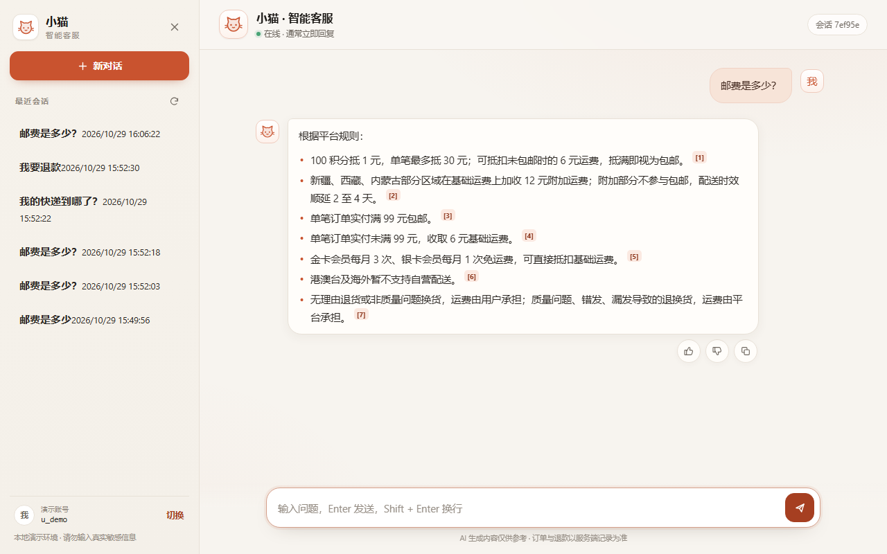
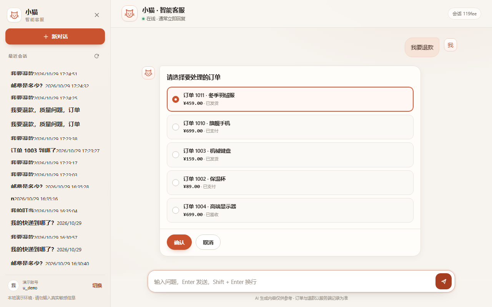
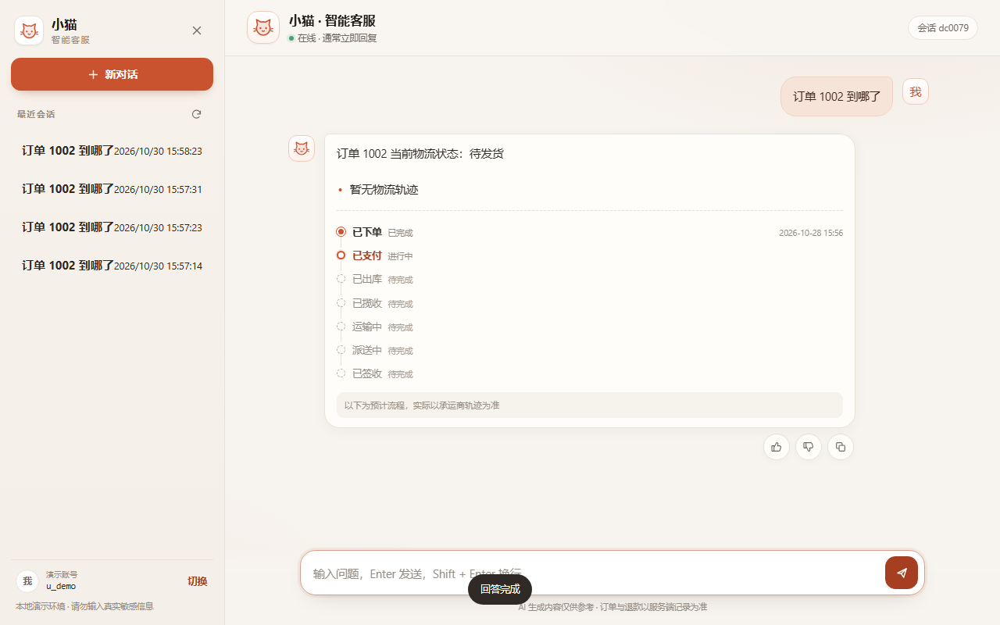
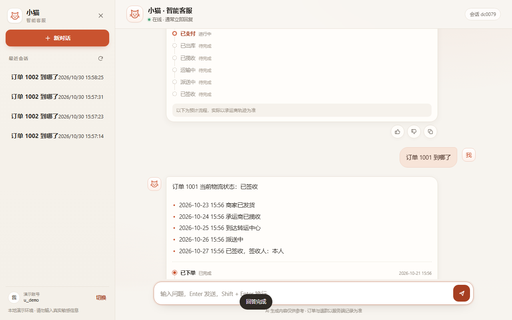
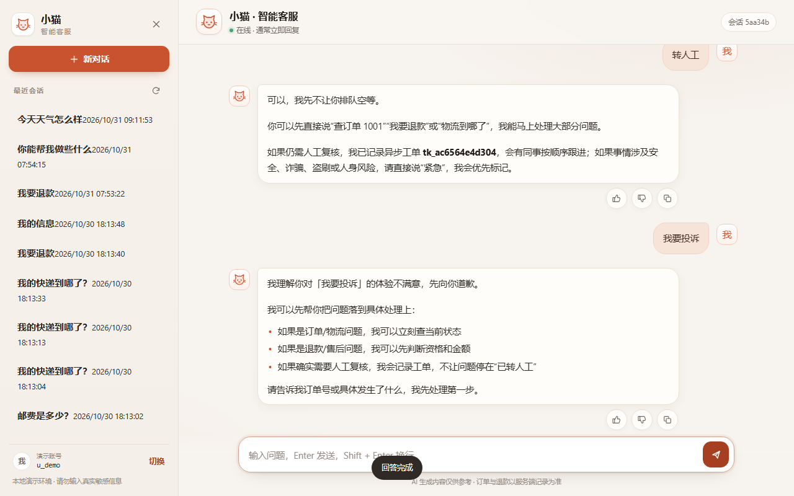
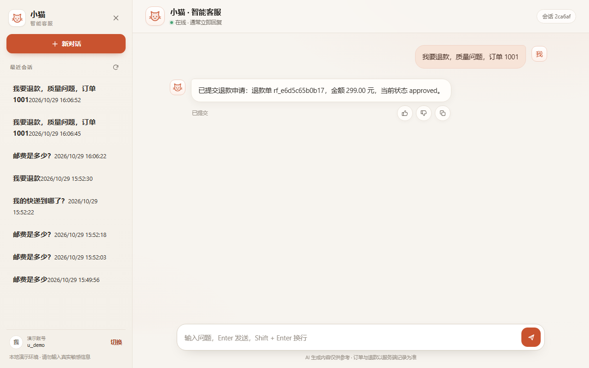
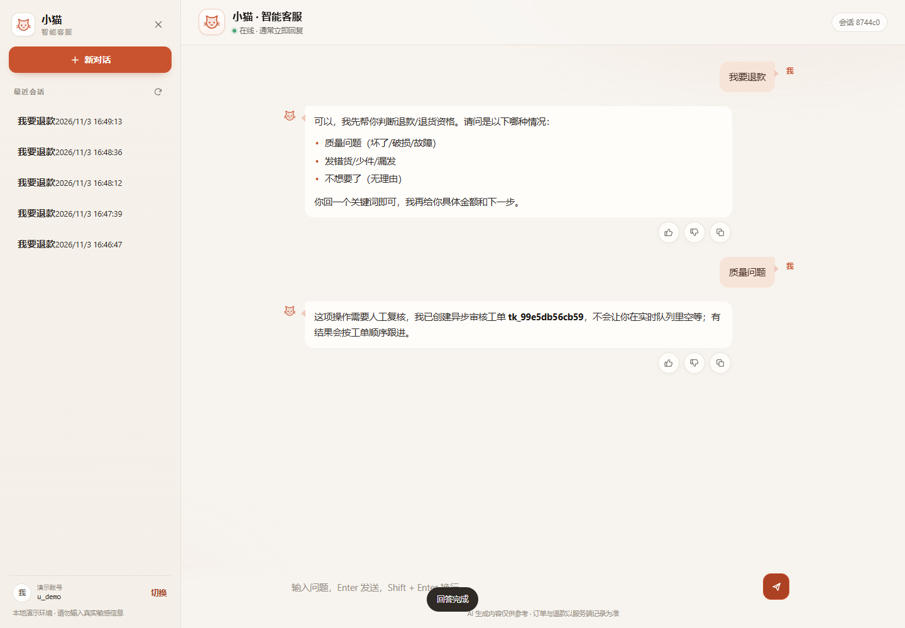

# 电商 AI 智能客服 Agent（P0-Lite）

一个可本地运行的电商客服演示：FastAPI + LangGraph + SQLite + 本地 BM25 检索 + SSE 对话页。















## 快速启动

```powershell
python -m pip install -r requirements.txt
python -m scripts.seed
python -m uvicorn app.main:app --host 127.0.0.1 --port 8000
```

打开 <http://127.0.0.1:8000>。演示账号为 `u_demo`，前端会自动带 `X-User-Id`。

### 启用 DeepSeek（可选）

默认 `LLM_MODE=mock`，不产生外部请求。需要真实模型时，在项目根目录创建 `.env`（参考 `.env.example`）：

```dotenv
LLM_MODE=deepseek
DEEPSEEK_API_KEY=你的本地密钥
DEEPSEEK_API_STYLE=auto
DEEPSEEK_MODEL=deepseek-chat
```

重启后访问 `/healthz`，`llm_mode=deepseek` 表示已配置；`degraded` 表示缺少 key 或请求不可用，此时自动回退确定性模板。不要把 `.env` 提交到仓库或贴到聊天里。

项目根目录已生成可用的本地 `.env`（gitignored）。如果你使用中转站，把 `DEEPSEEK_BASE_URL` 填到中转站要求的完整前缀（例如 `https://relay.example.com/v1`），并填写 `DEEPSEEK_MODEL` 与 `DEEPSEEK_API_KEY`；三项缺一即保持 `degraded`。`DEEPSEEK_API_STYLE` 默认 `auto`，会优先请求 Chat Completions，遇到 404 时自动切换到 Responses API；也可以显式设为 `chat` 或 `responses`。

### 在 VS Code 跑测试

本项目已带 `.venv` 配置；重新拉代码后先建环境：

```powershell
python -m venv .venv
.\.venv\Scripts\python.exe -m pip install -r requirements.txt
```

VS Code：

1. `Ctrl+Shift+P` → `Python: Select Interpreter` → 选择 `.venv\Scripts\python.exe`；
2. 左侧 **Testing** 图标 → `Run All Tests`；
3. 或 `Ctrl+Shift+B` 运行 `pytest: full suite`；
4. 或终端：

```powershell
.\.venv\Scripts\python.exe -m pytest -q
```

已预置 `.vscode/settings.json`、`launch.json`、`tasks.json` 和扩展推荐，不需要手改路径。

也可以：

```powershell
docker compose up --build
# http://127.0.0.1:8080
```

Docker 模式下业务库和 checkpoint 保存在 named volume `mewhelp_data` 的 `/app/dbdata`，不在宿主机 `app.db`：

- `docker compose down` 保留数据；
- `docker compose up -d --build` 保留数据；
- **`docker compose down -v` 会删除卷**，升级时不要使用；
- 备份示例：

```powershell
docker compose stop app
docker run --rm -v mewhelp_data:/data -v "${PWD}\backups:/backup" alpine `
  tar czf /backup/mewhelp-data.tgz -C /data .
docker compose start app
```

当前本机迁移数据：12 笔订单、6 个会话、12 条消息，均在 `mewhelp_data` 卷中。

## 已实现（P0-Lite）

- 14 类意图规则识别（含 `out_of_scope`/`needs_clarify`）+ 订单号/退款原因槽位 + 指代改写。
- 本地混合检索：BM25 + 字符 n-gram 余弦 + RRF + 轻量 rerank；政策 Top8 / 商品 Top5。
- SSE 对话：`meta → citation → token → done`；退款/订单选择使用 `interrupt`，`/chat/resume` 继续。
- 订单/物流查询；退款资格、金额、确认令牌、退款申请；取消/未支付/转人工出口。
- 物流完整历史：已签收订单 ≥5 条轨迹，最后一条“已签收”；查询不截断。
- 物流 7 步预期流程：done/current/pending，pending 灰色“待完成”，固定灰色提示，不展示未来 ETA。
- Answer-first：范围外问题先复述 + 边界 + 可执行下一步；非紧急不实时转人工，投诉先共情，紧急走白名单。
- 50 条“机械回复/答非所问”评测集；`pytest` 全量运行。
- P1a 最小切片：`POST /api/v1/after-sales/plan`（preview-only）+ 200 条 ticket planner 评测；只做判责建议，不执行退款。
- SQLite 会话/消息/订单/退款/工单/反馈/中断/确认令牌；LangGraph `SqliteSaver` 支持同进程/重启恢复。
- 对话气泡（助手/用户）、**订单/退款卡嵌入气泡**、圆形点赞/点踩/复制按钮、引用展示、会话历史、只读指标 API。
- v1.0 会话连续性：`state_json` pending 槽位、24 轮/48 条有界上下文、16000 token 预算、滚动摘要；退款原因短答不再被误判为范围外。
- v1.0 气泡视觉：头像去方框、气泡去硬边框/阴影、保留单一 tail；输入区无红框，键盘焦点仅保留 1px 底线。
- 可选 DeepSeek：`LLM_MODE=deepseek` + `DEEPSEEK_API_KEY` 启用 OpenAI-compatible 调用；无 key/401/429/超时自动回退 mock。
- 测试账户 `u_demo` 内置 12 笔订单，覆盖待支付/已支付/已发货/已签收/已取消/已退款/高金额/特殊品类/超期。
- 自测：`python -m pytest -q`（44 个测试）。

## 当前降级/边界

- 本地无 MySQL/Milvus/BGE-M3/Langfuse，使用 SQLite + 本地 BM25/字符向量；生产替换为 Milvus/BGE-M3 适配器。
- 默认 `LLM_MODE=mock`，回答由检索/规则/模板生成；DeepSeek 中转站已实测通过 `/responses`，`/chat/completions` 不可用时会自动切换。
- P0-Lite 仅本地单实例，`X-User-Id` 不是安全边界；公网前必须完成 JWT/RBAC/多实例/PII 审计。
- 这是演示实现，不包含真实订单/支付/物流系统；金额规则以 `data/knowledge` 与 `app/refunds.py` 为准，上线前需业务签字。

## 目录

- `app/`：FastAPI、LangGraph、检索、退款、SQLite 模型。
- `web/`：原生 HTML/CSS/JS 对话页。
- `data/knowledge/`：运费/退换/商品 FAQ 样例。
- `data/eval/`：200 条脱敏工单数据集（150 dev / 50 holdout）与校验脚本。
- `research/`：求职作品证据包（招募话术、访谈提纲、脱敏规则、评分表、作品集叙事）。
- `tests/`：API/SSE/退款/检索单元与集成测试。
- `docs/`：需求、方案、调研、索引；根目录 `CONTEXT.md` 为执行范围与验收基线。
